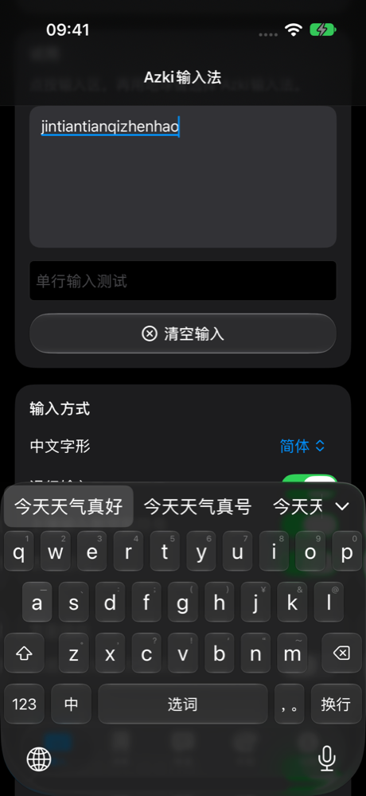
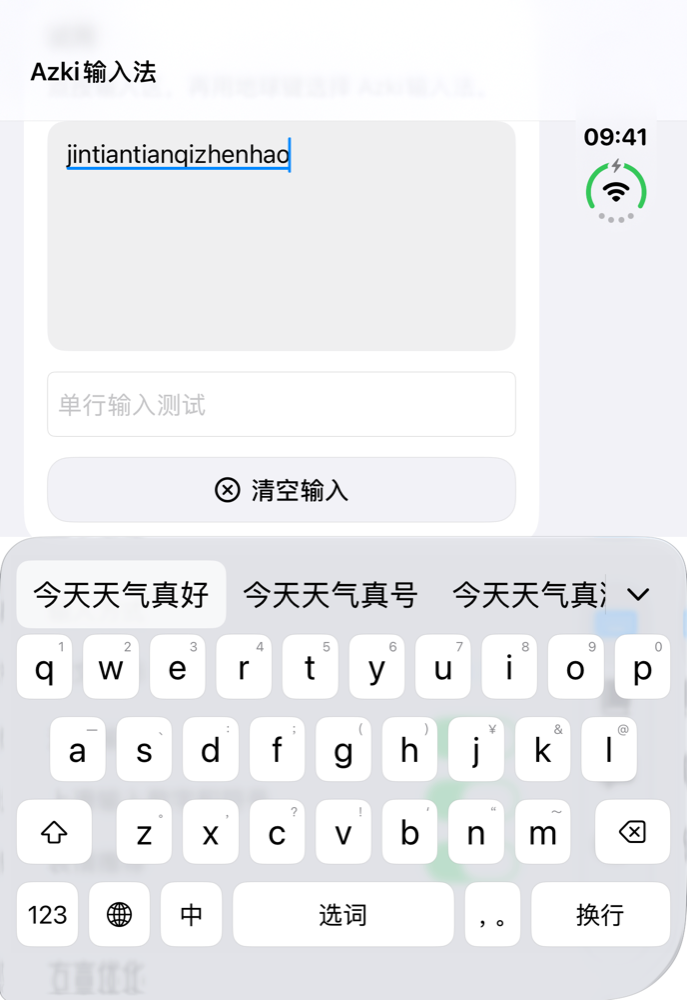
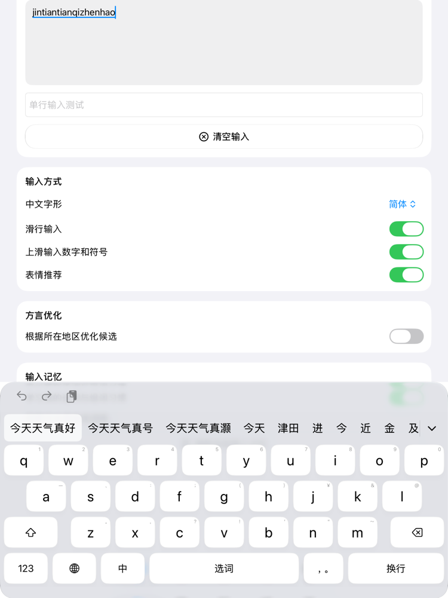

# Azki输入法

数据完全在本地处理的高安全性、高隐私性 iOS / iPadOS 键盘。支持中文拼音（简体、繁體、台灣、香港）、English 和日本語，词库随 App 提供，键盘不发起任何网络请求。

| iPhone | iPhone Duo | iPad |
| --- | --- | --- |
|  |  |  |

## 产品功能

**输入**
- 中文拼音长句连续输入、简拼、单字优先、错拼和模糊音修复，由开源词频和二元词组模型驱动。
- 中文字形可选简体、繁體、台灣（含用词转换）、香港（字形）。
- 英文词条补全，日文罗马字和假名候选。
- 滑行输入、上滑输入数字和符号、长按滑动选择大写和字母变体。
- 表情推荐，根据输入的词推荐 Emoji。
- 语音输入：由主 App 在设备上识别，文字回到键盘。

**打字手感**
- 多指同时按键，键盘全区域都有触控，按键缝隙也能触发。
- 手指落在缝隙时，纠错系统会把相邻按键一起考虑。
- 候选栏原生无吸附滚动，连续打字时不会误选候选词。

**个性化**
- 输入记忆：常用的词逐步靠前，长期不用的自动降权；只保存在本机，可一键清除。
- 方言优化：33 个地区可选，提高当地常用词的排序，并按地区习惯补充句尾语气词。
- 自定义词库（TSV 导入）、快捷短语、粘贴板入口。
- 主题、毛玻璃 / 液态玻璃 / 纯色材质、圆角、单个按键配色和按键震动。

**适配**
- iPhone、iPad 和 iPhone Duo，横竖屏，导航使用系统原生组件。

完整说明见 [docs/FEATURES.md](docs/FEATURES.md)。

## 隐私

- 键盘没有网络代码，`scripts/check-offline.py` 在构建时检查，没有遥测和云端候选。
- 词库、短语、外观和输入记忆只存放在本机。
- 密码、验证码、手机号、银行卡、邮箱和网址等字段不学习。
- 语音强制在设备上识别，录音不上传。
- “允许完全访问”只用于 App 与键盘共享数据、震动和粘贴。开启时 iOS 会显示键盘可以联网的系统提示，这是系统文案。

完整内容见[隐私政策](PRIVACY.md)。

## 构建

需要 Xcode 27 或更新版本。Xcode 工程由脚本生成：

```sh
python3 scripts/generate-project.py
open AzkiInputMethod.xcodeproj
```

词库重建方法见 [DataSources/README.md](DataSources/README.md)，方言数据说明见 [docs/DIALECT-DATA.md](docs/DIALECT-DATA.md)。

## 使用的项目和协议

Azki 的代码和图形采用 [MIT](LICENSE)。代码只使用 Apple 公开 SDK 和系统 SQLite，没有第三方运行时依赖。数据来源如下：

| 项目 | 用途 | 协议 |
| --- | --- | --- |
| [CC-CEDICT](https://www.mdbg.net/chinese/dictionary?page=cc-cedict) | 中文词条 | CC BY-SA 4.0 |
| [jieba](https://github.com/fxsjy/jieba) | 中文词频 | MIT |
| [wordfreq](https://github.com/rspeer/wordfreq) | 中文词频 | CC BY-SA 4.0 |
| [OPUS OpenSubtitles](https://opus.nlpl.eu/OpenSubtitles.php) | 二元词组统计（只用计数） | 见 ATTRIBUTION |
| [Unihan](https://www.unicode.org/charts/unihan.html) | 汉字读音 | Unicode License |
| [Wordnik wordlist](https://github.com/wordnik/wordlist) | 英文词条 | MIT |
| [JMdict](https://www.edrdg.org/jmdict/j_jmdict.html) | 日文词条 | CC BY-SA 4.0 |
| [Unicode CLDR](https://cldr.unicode.org/) | 表情关键词 | Unicode License |
| [OpenCC](https://github.com/BYVoid/OpenCC) | 简繁、台湾、香港转换 | Apache-2.0 |
| Wiktionary、CC-Canto、Wikipedia 和方言研究文献 | 方言词库 | 词库整体为 CC BY-SA 4.0，逐条来源见 `DataSources/dialect-sources.json` |

完整署名和许可正文在 [Resources/Licenses](Resources/Licenses)，App 的「说明」页也可以查看。

## 联系方式

作者：AzumaChiaki

邮箱：[azu@azki.ai](mailto:azu@azki.ai)
